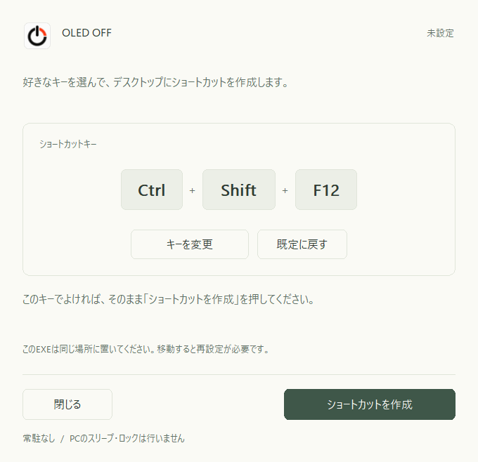

# OLED_OFF

キーを押すだけで、Windowsのモニターを消灯するアプリです。

既定のキーは **Ctrl+Shift+F12**。好きなキーに変更できます。PCのスリープやロックは行いません。



## ダウンロード

[最新版の配布ページ](https://github.com/kyokutyou/OLED_OFF/releases/latest)から **OLED_OFF-Windows-x64.zip** をダウンロードしてください。

**Windows 10/11の64ビット版（x64）** に対応しています。管理者権限や追加ソフトは不要で、常駐しません。EXEは未署名です。

## 使い方

1. ZIPを展開し、`Setup.exe` を使い続ける場所に置きます。
2. `Setup.exe` を開きます。
3. 「ショートカットを作成」を押します。
4. 設定画面を閉じ、**Ctrl+Shift+F12** を押すと消灯します。

別のキーを使う場合は、作成前に「キーを変更」を押し、使いたいキーを同時に押して離してください。

デスクトップの「モニターを消灯」からも使えます。通常はマウスやキーボードの操作で再点灯します。

## キーの変更・更新・削除

- **キーを変更する：** `Setup.exe` を開き、「キーを変更」で選び直して「変更を保存」を押します。入力は Esc で取り消せます。
- **アプリを更新する：** 設定画面を閉じ、同じ場所のEXEを更新版に置き換えます。「設定を更新」が表示されたら押してください。現在のキーは引き継がれます。
- **削除する：** デスクトップのショートカットと、展開したファイルを削除します。アイコンの保存先 `%LOCALAPPDATA%\OLED_OFF\icons` も削除できます。

## 注意点

- キーは Ctrl または Alt と、F1〜F12・英字・数字を組み合わせます。Shiftも使えます。Windowsキーは使えません。
- キーが他のアプリと重なる場合は変更してください。設定が反映されるまで、少し時間がかかることがあります。
- EXEとショートカットは設定した場所に置いてください。EXEを移動した場合は、ショートカットを削除して設定し直します。
- 消灯や再点灯の動作は、モニターや入力機器などの環境によって変わる場合があります。

## ソースからビルド

Visual StudioまたはBuild Toolsの「C++によるデスクトップ開発」とWindows SDKが必要です。リポジトリのフォルダーで実行してください。

```powershell
powershell.exe -NoProfile -ExecutionPolicy Bypass -File .\Build.ps1
```

テストに成功すると、`dist` にEXEと配布ZIPを作成します。自動テストでは、実際の画面やデスクトップショートカットは変更しません。

## ライセンス

[MIT License](LICENSE)。Copyright (c) 2026 kyokutyou。
